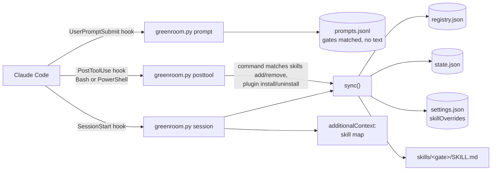

# Architecture

## Overview

greenroom is a single stdlib-only Python script that Claude Code runs through three hooks. It reads the user's installed skills, groups them into families, hides family members from the model with `skillOverrides: "user-invocable-only"` and writes one visible *gate* skill per family. At session start it injects a short map so the model knows the gates exist. There is no server, no network access and no dependency outside the Python standard library.



## Components

| Component | Responsibility | Location |
|---|---|---|
| `greenroom.py` | CLI and hook entry point: `sync`, `check`, `session`, `posttool`, `prompt`, `status`, `usage` | repo root, copied to `<claude dir>/greenroom/` on install |
| `install.py` | Preview (`--dry-run`), install, uninstall; edits hooks in `settings.json` | repo root (runs from the clone) |
| `registry.example.json` | Starting registry: families, keywords, stack detection, suggestions, notes | repo root |
| `registry.json` | Single source of truth for families and their members, kept current by `sync` | `<claude dir>/greenroom/` |
| `state.json` | Previous value of every override greenroom changed, so uninstall can restore it; `installed_at` and `installed_session`, written once by the session hook the first time it prints the map | `<claude dir>/greenroom/` |
| `prompts.jsonl` | One line per user prompt: UTC time, session id, cwd and `{gate: [keywords]}` matched; never the prompt text | `<claude dir>/greenroom/` |
| Gate skills | Generated `SKILL.md` per family with the member table and usage rules | `<claude dir>/skills/<gate>/` |
| Tests | `unittest` suite run against a throwaway `CLAUDE_CONFIG_DIR` | `tests/test_greenroom.py` |

`<claude dir>` is `$CLAUDE_CONFIG_DIR` or `~/.claude`.

## Data flow

1. **Session start.** Claude Code calls `greenroom.py session` with the hook payload on stdin. `sync()` runs:
   - `inventory()` reads the frontmatter of every `<claude dir>/skills/*/SKILL.md`;
   - skills no longer installed are pruned from the registry;
   - new skills are classified by keyword hits (`classify()`): at least 2 hits and a clear winner, otherwise they go to `pending` and stay visible;
   - `build()` regenerates non-manual gates, sets members to `user-invocable-only`, keeps gates visible and converts any `"off"` to `user-invocable-only`. Every override it touches is recorded first in `state.json`.

   Then `session_text()` builds the map: gates, the one-line `RULES_LINE` (built from `SKILL_RULES`, the same constant every generated gate lists, so the two cannot drift), registry `notes`, the gates this repo needs (from `package.json` deps, config files and CDN scripts in `index.html`), file-based `suggestions`, maintenance notes and `check()` warnings. It is printed as `hookSpecificOutput.additionalContext`. If `sync()` raises, the map is still printed with the error.
2. **After a tool call.** `greenroom.py posttool` reads `tool_input.command`. Only when it matches `INSTALL_RE` (skills add/remove/update, plugin install/uninstall/enable/disable, or an edit to `registry.json`) does it run `sync()` and report the changes.
3. **On every prompt.** `greenroom.py prompt` reads `prompt`, `session_id` and `cwd` from the `UserPromptSubmit` payload, matches the prompt against each family's `keywords` (`keyword_hits()`: one hit is enough because prompts are short; a keyword must start a word, and keywords of 3 letters or less must be a whole word) and appends the result to `prompts.jsonl`. It stores no prompt text, prints nothing (so it does not change the behavior it measures) and exits 0 on any error.
4. **On demand.** `check` exits 1 on orphans (hidden skills no gate lists), hidden gates, missing gates or `"off"` overrides. `status` prints counts per family. `usage` reads `<claude dir>/projects/*/*.jsonl` (and `*/<session>/subagents/*.jsonl`, folded into their parent session) line by line, JSON-parsing only lines with a `tool_use` or a `<command-name>`, and reports map delivery, gate entries, hidden-skill reads and reads in a session that never entered their gate. Entering a gate is the `Skill` tool, the user's `/gate`, reading the gate's own `SKILL.md` (gates send the model to each other's files), a "Base directory for this skill" load of the gate, or the user's `/name` of a hidden skill, which enters its family's gate. Each load is matched to the Skill call or `/name` that caused it, so parallel calls are not double-counted. A subagent's reads count in the session that launched it, so they are inside a gate the parent entered. Sessions whose first timestamp is before the start are left out: they could never have received the map. The start is `--since`, or by default the install, resolved before the full scan so files last written before it are skipped by mtime: the first timestamp of the session recorded in `state.json` (`installed_session`, falling back to `installed_at`), or, for installs older than that field, a cheap substring pass for the first session whose transcript has the map at `SessionStart:startup`. A session opened before the install gets the map too when it is resumed or compacted, so only startup maps date it. File times of `state.json` and `registry.json` cannot: every sync rewrites them and file creation time is not portable. `--all` counts every transcript. A read is a `Read` of `<claude dir>/skills/<name>/SKILL.md`, or a Bash/PowerShell command with a read verb (`cat`, `head`, `sed`, `Get-Content`…) on that local path; an `Agent` whose prompt names it is reported apart as delegated. Remote paths (`gh api …/skills/x/SKILL.md`) and files that merely mention the path are not reads. Sessions whose `entrypoint` starts with `sdk` are not counted as interactive. Finally it crosses `prompts.jsonl` with the transcripts: for each prompt that matched a gate, did the session enter that gate or read a skill of its family (same criteria) between that prompt and the next one of the same session? Those that did not are reported as possible improvisations: candidates to review, not confirmed failures, with whether the gate had been entered earlier in the session.

Every write goes through `write_if_changed()` or compares before writing, so a sync with nothing new touches no file.

## Where things live

```
greenroom/
├── greenroom.py            # all runtime logic
├── install.py              # install / uninstall / dry-run
├── registry.example.json   # default families
├── tests/test_greenroom.py
├── docs/adr/               # architecture decisions
├── assets/                 # logo, wordmarks, social preview
├── README.md / README.es.md
└── LICENSE                 # MIT
```

## External services

None. greenroom only reads and writes files under `<claude dir>`. It depends on Claude Code's hook contract and the `skillOverrides` setting.

## Decisions

- [ADR-0001: Ship greenroom as a stdlib-only Python script driven by Claude Code hooks](docs/adr/0001-stdlib-python-script-driven-by-hooks.md)
