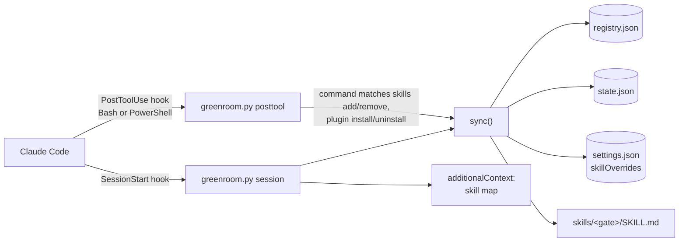

# Architecture

## Overview

greenroom is a single stdlib-only Python script that Claude Code runs through two hooks. It reads the user's installed skills, groups them into families, hides family members from the model with `skillOverrides: "user-invocable-only"` and writes one visible *gate* skill per family. At session start it injects a short map so the model knows the gates exist. There is no server, no network access and no dependency outside the Python standard library.



## Components

| Component | Responsibility | Location |
|---|---|---|
| `greenroom.py` | CLI and hook entry point: `sync`, `check`, `session`, `posttool`, `status` | repo root, copied to `<claude dir>/greenroom/` on install |
| `install.py` | Preview (`--dry-run`), install, uninstall; edits hooks in `settings.json` | repo root (runs from the clone) |
| `registry.example.json` | Starting registry: families, keywords, stack detection, suggestions, notes | repo root |
| `registry.json` | Single source of truth for families and their members, kept current by `sync` | `<claude dir>/greenroom/` |
| `state.json` | Previous value of every override greenroom changed, so uninstall can restore it | `<claude dir>/greenroom/` |
| Gate skills | Generated `SKILL.md` per family with the member table and usage rules | `<claude dir>/skills/<gate>/` |
| Tests | `unittest` suite run against a throwaway `CLAUDE_CONFIG_DIR` | `tests/test_greenroom.py` |

`<claude dir>` is `$CLAUDE_CONFIG_DIR` or `~/.claude`.

## Data flow

1. **Session start.** Claude Code calls `greenroom.py session` with the hook payload on stdin. `sync()` runs:
   - `inventory()` reads the frontmatter of every `<claude dir>/skills/*/SKILL.md`;
   - skills no longer installed are pruned from the registry;
   - new skills are classified by keyword hits (`classify()`): at least 2 hits and a clear winner, otherwise they go to `pending` and stay visible;
   - `build()` regenerates non-manual gates, sets members to `user-invocable-only`, keeps gates visible and converts any `"off"` to `user-invocable-only`. Every override it touches is recorded first in `state.json`.

   Then `session_text()` builds the map: gates, registry `notes`, the gates this repo needs (from `package.json` deps, config files and CDN scripts in `index.html`), file-based `suggestions`, maintenance notes and `check()` warnings. It is printed as `hookSpecificOutput.additionalContext`. If `sync()` raises, the map is still printed with the error.
2. **After a tool call.** `greenroom.py posttool` reads `tool_input.command`. Only when it matches `INSTALL_RE` (skills add/remove/update, plugin install/uninstall/enable/disable, or an edit to `registry.json`) does it run `sync()` and report the changes.
3. **On demand.** `check` exits 1 on orphans (hidden skills no gate lists), hidden gates, missing gates or `"off"` overrides. `status` prints counts per family.

Every write goes through `write_if_changed()` or compares before writing, so a sync with nothing new touches no file.

## Where things live

```
greenroom/
├── greenroom.py            # all runtime logic
├── install.py              # install / uninstall / dry-run
├── registry.example.json   # default families
├── tests/test_greenroom.py
├── docs/adr/               # architecture decisions
├── README.md / README.es.md
└── LICENSE                 # MIT
```

## External services

None. greenroom only reads and writes files under `<claude dir>`. It depends on Claude Code's hook contract and the `skillOverrides` setting.

## Decisions

- [ADR-0001: Ship greenroom as a stdlib-only Python script driven by Claude Code hooks](docs/adr/0001-stdlib-python-script-driven-by-hooks.md)
