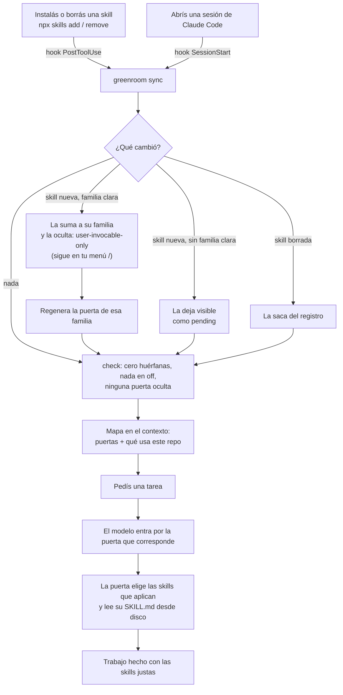

<h1 align="center">
  <picture>
    <source media="(prefers-color-scheme: dark)" srcset="assets/logo-wordmark-dark.svg">
    
  </picture>
</h1>

**Cientos de skills de Claude Code fuera del contexto, sin perder ninguna.**

[English](README.md)

En un teatro, el *green room* es la sala donde los artistas esperan fuera de escena. No ocupan el escenario, pero están listos, y el regidor sabe quién está ahí y los llama cuando les toca. greenroom hace eso con las [skills de Claude Code](https://code.claude.com/docs/en/skills).

## Inicio rápido

```bash
git clone https://github.com/PapiScholz/greenroom
cd greenroom
python install.py --dry-run     # 1. vista previa: a qué familia iría cada skill (no escribe nada)
python install.py               # 2. instala (pregunta antes de ocultar)
```

Después:

3. **Abrí una sesión nueva de Claude Code.** El modelo arranca con un *mapa de skills*: qué puertas hay y cuáles necesita el repo abierto.
4. **Seguí trabajando como siempre.** Instalá skills con `npx skills add …` como de costumbre. greenroom las clasifica, las oculta y las suma a su puerta solo.
5. **Pedí lo que necesites.** El modelo entra por la puerta que corresponde (`gate-motion`, `gate-data`…), que carga solo las skills que hacen falta. También podés escribir `/gate-motion` o el `/nombre` de cualquier skill oculta: siguen todas en tu menú.

¿Te olvidaste cómo funciona? Corré:

```bash
python ~/.claude/greenroom/greenroom.py status
```

## El problema

Cada skill instalada mete su nombre y su descripción en el contexto de **todas** las sesiones. Pasadas unas decenas, eso pesa. Cuando el listado supera ~1% del contexto, Claude Code [recorta las descripciones](https://code.claude.com/docs/en/skills) de las que menos usás, y el modelo elige peor o nunca encuentra la skill justa.

Los arreglos de siempre lo empeoran:

- **Desinstalar** pierde la skill.
- **`skillOverrides: "off"`** ahorra contexto, pero además saca `/nombre` de **tu** menú. Encima, nada le avisa al modelo que la skill existe, así que improvisa.

## Cómo funciona



### Las cinco piezas

1. **Familias y puertas.** Las skills se agrupan en familias: motion, diseño, infra, datos, testing, backend, escritorio, marketing, investigación y proceso. Las podés editar. Cada familia tiene una **puerta**, una única skill visible (~300 caracteres de contexto) que elige las que hacen falta y lee su `SKILL.md` desde disco.
2. **Ocultas, nunca apagadas.** Las skills de cada familia quedan en `"user-invocable-only"`: no ocupan contexto y siguen en tu menú `/`. greenroom nunca escribe `"off"` y convierte el que encuentre.
3. **Mapa al iniciar sesión.** Un hook `SessionStart` agrega ~1.500 caracteres al contexto:
   - qué hay oculto;
   - qué puertas existen;
   - cuáles necesita **este repo**.

   El stack lo detecta por `package.json`, por archivos de config (`wrangler.toml`, `playwright.config.ts`, `prisma/schema.prisma`…) y por librerías cargadas por CDN en sitios HTML de un solo archivo.
4. **Mantenimiento cero.** greenroom sincroniza al iniciar cada sesión y justo después de cada `skills add/remove` o `plugin install/uninstall`. En cada pasada clasifica las skills nuevas por palabras clave, las oculta, las suma a su puerta y poda las borradas. Si una skill no tiene familia clara, queda visible y el mapa la marca.
5. **Cero huérfanas.** `check` falla si:
   - alguna skill oculta no tiene puerta;
   - una puerta está oculta;
   - queda algo en `"off"`.

   El mapa de la sesión avisa cuando pasa.

En la máquina del autor (~300 skills), el listado bajó de ~30.000 a ~15.000 caracteres por sesión. Deshabilitar dos plugins con skills duplicadas ahorró otros ~11.000.

## Flujos de uso

| Querés… | Hacé esto |
|---|---|
| Agregar una skill | `npx skills add dueño/repo -g` y nada más: el hook PostToolUse la clasifica en el momento |
| Usar una skill oculta | Pedí la tarea y el modelo entra por la puerta. O escribí su `/nombre` |
| Ver qué hay y dónde | `python ~/.claude/greenroom/greenroom.py status` |
| Confirmar que no se perdió nada | `python ~/.claude/greenroom/greenroom.py check` (sale con 1 si hay huérfanas o puertas rotas) |
| Mover una skill de familia | Editá la lista `skills` de su familia en `~/.claude/greenroom/registry.json`; la próxima pasada lo aplica |
| Que una skill tuya quede siempre visible | Sumala a `keep_visible` en el registro |
| Ubicar una skill marcada `pending` | Sumala a la lista `skills` de una familia |
| Escribir una puerta a mano | Poné `"manual": true` en la familia. greenroom deja de pisar su `SKILL.md` y escribe al lado `references/skills-added.md` con las que tu texto todavía no menciona |
| Deshacer todo | `python install.py --uninstall` |

## Instalación en detalle

Requiere Python 3.9+ y Claude Code. Respeta `$CLAUDE_CONFIG_DIR`.

`install.py` hace cinco cosas:
- copia `greenroom.py` a `~/.claude/greenroom/`;
- crea `registry.json` desde `registry.example.json`, o desde `--registry ARCHIVO`;
- hace backup de `settings.json`;
- agrega dos hooks: `SessionStart`, y `PostToolUse` sobre `Bash|PowerShell`;
- corre la primera pasada.

`--yes` saltea la confirmación.

`--uninstall` revierte la instalación:
- restaura cada override que greenroom cambió (guarda el valor anterior de cada uno en `state.json`);
- quita los hooks;
- borra las puertas generadas.

No toca tus skills.

## El registro

`~/.claude/greenroom/registry.json` es la única fuente de verdad, y greenroom lo mantiene al día. Cada familia tiene:

| Campo | Qué es |
|---|---|
| `id`, `gate`, `title`, `summary` | Identidad de la familia, y nombre y descripción de su puerta |
| `keywords` | Sirven para clasificar las skills nuevas: hacen falta 2 coincidencias y un ganador claro, si no queda `pending` |
| `detect.deps`, `detect.files` | Señales de stack que ponen la puerta en "este repo usa…" |
| `skills` | Las de la familia; se llena solo |
| `manual` | `true` si la puerta la escribiste vos |

`suggestions` hace que el mapa recomiende una skill cuando a un repo git le faltan ciertos archivos. El ejemplo apunta a [repo-baseline](https://github.com/PapiScholz/repo-baseline): si falta `README.md`, `ARCHITECTURE.md` o `docs/adr`, el modelo la sugiere una vez. En los repos que ya los tienen no suma ninguna línea.

`notes` guarda líneas extra para el mapa, por ejemplo "las herramientas de Cloudflare llegan por el conector de claude.ai, no por el plugin" o "antes de lanzar subagentes, cargá la skill de orquestación".

## Límites

- **Las skills de plugins** no se ocultan con `skillOverrides`: se manejan con `/plugin`, y por proyecto si hace falta (`enabledPlugins` en `<repo>/.claude/settings.json`). Una puerta igual puede leer el `SKILL.md` de un plugin deshabilitado desde la caché.
- **La clasificación** usa palabras clave y es conservadora a propósito: ante la duda, la skill queda visible.
- **`settings.json` se reescribe** como JSON con sangría de 2. El contenido se conserva; el formato puede cambiar.
- **Las skills de proyecto** (`<repo>/.claude/skills`) no se clasifican. Los overrides aplican por nombre: ocultar una skill de usuario oculta también una de proyecto con el mismo nombre.

## Tests

```bash
python -m unittest discover tests
```

Cada test corre en un `CLAUDE_CONFIG_DIR` descartable. Se verificó con mutaciones: escribir `"off"`, desactivar la clasificación o reaccionar a cualquier comando ponen los tests en rojo.

## Documentación

- [Arquitectura](ARCHITECTURE.md)
- [Decisiones (ADRs)](docs/adr/)
- [Seguridad](SECURITY.md)
- Diseño: no aplica. greenroom es una CLI con dos hooks, sin interfaz, así que no hay `DESIGN.md`.

Estos documentos están en inglés.

## Licencia

[MIT](LICENSE)
