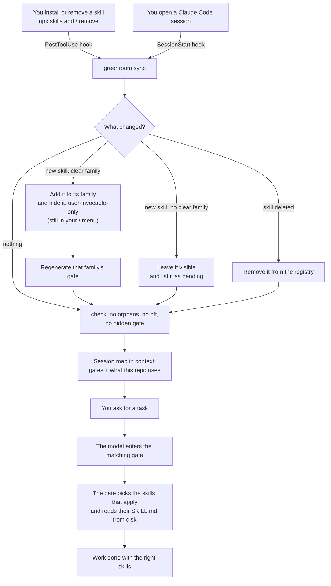

# greenroom

**Keep hundreds of Claude Code skills off the context window without ever losing them.**

[Español](README.es.md)

In a theater, the *green room* is where performers wait off stage: not taking up the stage, but ready, and the stage manager knows who is there and calls them on when it's their cue. greenroom does that for [Claude Code skills](https://code.claude.com/docs/en/skills).

## Quick start

```bash
git clone https://github.com/PapiScholz/greenroom
cd greenroom
python install.py --dry-run     # 1. preview: which family each of your skills would go to (writes nothing)
python install.py               # 2. install (asks before hiding anything)
```

Then:

3. **Open a new Claude Code session.** The model now starts with a short *skill map*: the gates that exist and the ones the current repo needs.
4. **Keep working as usual.** Install skills with `npx skills add …` as always. greenroom files each one under its family, hides it and lists it in the right gate on its own.
5. **Ask for anything.** The model enters the matching gate (`gate-motion`, `gate-data`…), which loads only the skills the task needs. You can also type `/gate-motion`, or any hidden skill's `/name`: they are all still in your menu.

Forgot how it works? Run this:

```bash
python ~/.claude/greenroom/greenroom.py status
```

## The problem

Every skill you install puts its name and description in the context of **every** session. Past a few dozen skills that gets expensive. Past ~1% of the context window, Claude Code [drops the descriptions](https://code.claude.com/docs/en/skills) of the skills you use least, so the model picks worse or never finds the skill that would have done the job right.

The usual fixes make it worse:

- **Uninstalling** loses the skill.
- **`skillOverrides: "off"`** saves the context, but it also removes `/name` from *your* menu. Nothing tells the model the skill exists, so it improvises instead of using it.

## How it works



### The five pieces

1. **Families and gates.** Skills are grouped into families: motion, design, infra, data, testing, backend, desktop, marketing, research and process. You can edit them freely. Each family has one visible **gate** skill (~300 chars in context) that picks the members a task needs and reads their `SKILL.md` straight from disk.
2. **Hidden, never off.** Members get `skillOverrides: "user-invocable-only"`. That keeps them out of the model's context, but `/name` stays in your menu. greenroom never writes `"off"` and converts any it finds.
3. **A map at session start.** A `SessionStart` hook injects ~1.5k chars into the context:
   - what is hidden;
   - which gates exist;
   - which gates **this repo** needs.

   Stack detection reads `package.json`, config files (`wrangler.toml`, `playwright.config.ts`, `prisma/schema.prisma`…) and libraries loaded by CDN in single-file HTML sites.
4. **Zero maintenance.** greenroom syncs at every session start and right after any `skills add/remove` or `plugin install/uninstall`. Each sync classifies new skills by keyword, hides them, lists them in their gate and prunes deleted ones. A skill with no clear family stays visible and the map flags it.
5. **No orphans.** `check` fails when:
   - a hidden skill can't be reached through any gate;
   - a gate is hidden;
   - anything is `"off"`.

   The session map warns you when that happens.

Measured on the author's machine (~300 skills), the skill listing went from ~30k to ~15k characters per session. Disabling two plugins whose skills were duplicated saved another ~11k.

## Workflows

| You want to… | Do this |
|---|---|
| Add a skill | `npx skills add owner/repo -g`. Nothing else: the PostToolUse hook files it right away. |
| Use a hidden skill | Just ask; the model goes through the gate. Or type its `/name`. |
| See what is installed where | `python ~/.claude/greenroom/greenroom.py status` |
| Make sure nothing is lost | `python ~/.claude/greenroom/greenroom.py check` (exit 1 on orphans or broken gates) |
| Move a skill to another family | Edit its family's `skills` list in `~/.claude/greenroom/registry.json`; the next sync applies it. |
| Keep one of your own skills always visible | Add it to `keep_visible` in the registry. |
| Place a skill flagged as `pending` | Add it to a family's `skills` list. |
| Write a gate by hand | Set `"manual": true` on the family. greenroom stops overwriting its `SKILL.md` and writes `references/skills-added.md` next to it with any members your text doesn't mention yet. |
| Undo everything | `python install.py --uninstall` |

## Install details

Requires Python 3.9+ and Claude Code. `$CLAUDE_CONFIG_DIR` is honored.

`install.py` does five things:
- copies `greenroom.py` to `~/.claude/greenroom/`;
- creates `registry.json` from `registry.example.json`, or from `--registry FILE`;
- backs up `settings.json`;
- adds two hooks: `SessionStart`, and `PostToolUse` on `Bash|PowerShell`;
- runs the first sync.

`--yes` skips the confirmation.

`--uninstall` reverses the install:
- restores every override greenroom changed (it records the previous value of each one in `state.json`);
- removes the hooks;
- deletes the generated gates.

Your skills are never touched.

## The registry

`~/.claude/greenroom/registry.json` is the single source of truth, and greenroom keeps it current. Each family has:

| Field | Meaning |
|---|---|
| `id`, `gate`, `title`, `summary` | Identity of the family and the name and description of its gate |
| `keywords` | Used to classify new skills: at least 2 hits and a clear winner, otherwise `pending` |
| `detect.deps`, `detect.files` | Stack signals that put the gate in "this repo uses…" |
| `skills` | Members, filled in automatically |
| `manual` | `true` if you wrote the gate yourself |

`suggestions` makes the map recommend a skill when a git repo is missing some files. The example points at [repo-baseline](https://github.com/PapiScholz/repo-baseline): if `README.md`, `ARCHITECTURE.md` or `docs/adr` is missing, the model suggests it once. Repos that already have them get no extra line.

`notes` holds extra lines for the session map, for example "Cloudflare tools come from the claude.ai connector, not the plugin" or "load the orchestration skill before spawning subagents".

## Limits

- **Plugin skills** are not affected by `skillOverrides` ([docs](https://code.claude.com/docs/en/skills)). Manage them with `/plugin`, per project if needed (`enabledPlugins` in `<repo>/.claude/settings.json`). A gate can still read a disabled plugin's `SKILL.md` from the plugin cache.
- **Classification** is keyword-based and conservative on purpose: when in doubt, the skill stays visible.
- **`settings.json` is rewritten** as 2-space JSON. Content is preserved; formatting may change.
- **Project skills** (`<repo>/.claude/skills`) are not classified. Overrides apply by name, so hiding a user skill also hides a project skill with the same name.

## Tests

```bash
python -m unittest discover tests
```

Every test runs in a throwaway `CLAUDE_CONFIG_DIR`. Mutations were checked: writing `"off"`, disabling classification or matching every command each turn tests red.

## Documentation

- [Architecture](ARCHITECTURE.md)
- [Decisions (ADRs)](docs/adr/)
- [Security](SECURITY.md)
- Design: does not apply. greenroom is a CLI and a pair of hooks with no UI, so there is no `DESIGN.md`.

## License

[MIT](LICENSE)
