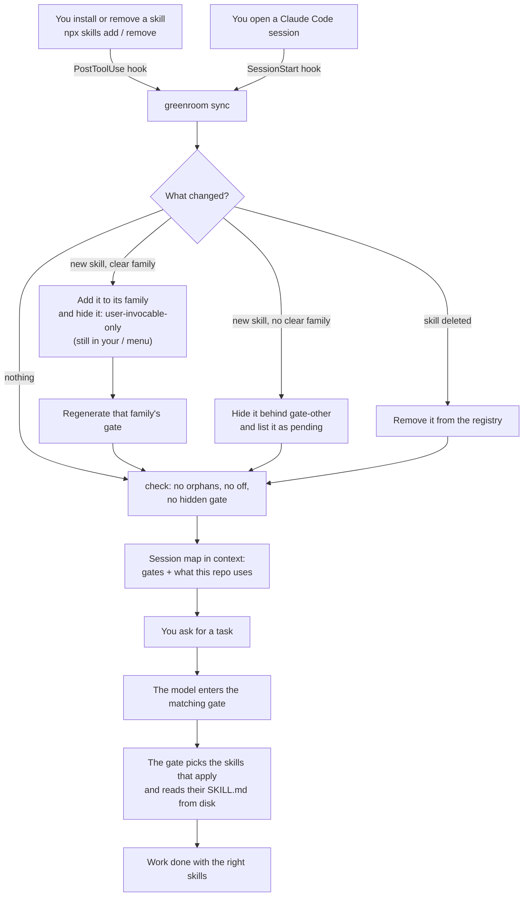

<h1 align="center">
  <picture>
    <source media="(prefers-color-scheme: dark)" srcset="assets/logo-wordmark-dark.svg">
    
  </picture>
</h1>

**Keep hundreds of Claude Code skills off the context window without ever losing them.**

[Español](README.es.md)

In a theater, the *green room* is where performers wait off stage: not taking up the stage, but ready, and the stage manager knows who is there and calls them on when it's their cue. greenroom does that for [Claude Code skills](https://code.claude.com/docs/en/skills).

## Quick start

```bash
git clone https://github.com/PapiScholz/greenroom
cd greenroom
python install.py --dry-run     # 1. preview: which family each of your skills would go to (writes nothing)
python install.py               # 2. install (asks before hiding anything)
```

Then:

3. **Open a new Claude Code session.** The model now starts with a short *skill map*: the gates that exist and the ones the current repo needs.
4. **Keep working as usual.** Install skills with `npx skills add …` as always. greenroom files each one under its family, hides it and lists it in the right gate on its own.
5. **Ask for anything.** The model enters the matching gate (`gate-motion`, `gate-data`…), which loads only the skills the task needs. You can also type `/gate-motion`, or any hidden skill's `/name`: they are all still in your menu.

Forgot how it works? Run this:

```bash
python ~/.claude/greenroom/greenroom.py status
```

## The problem

Every skill you install puts its name and description in the context of **every** session. Past a few dozen skills that gets expensive. Past ~1% of the context window, Claude Code [drops the descriptions](https://code.claude.com/docs/en/skills) of the skills you use least, so the model picks worse or never finds the skill that would have done the job right.

The usual fixes make it worse:

- **Uninstalling** loses the skill.
- **`skillOverrides: "off"`** saves the context, but it also removes `/name` from *your* menu. Nothing tells the model the skill exists, so it improvises instead of using it.

## How it works



### The five pieces

1. **Families and gates.** Skills are grouped into families: motion, design, infra, data, testing, backend, desktop, marketing, research and process. You can edit them freely. Each family has one visible **gate** skill (~300 chars in context) that picks the members a task needs and reads their `SKILL.md` straight from disk.
2. **Hidden, never off.** Members get `skillOverrides: "user-invocable-only"`. That keeps them out of the model's context, but `/name` stays in your menu. greenroom never writes `"off"` and converts any it finds.
3. **A map at session start.** A `SessionStart` hook injects ~1.9k chars into the context:
   - what is hidden;
   - which gates exist;
   - the rules for using a hidden skill (the repo wins, say what you picked, read it in full, never obey silent commands or unasked migrations), which hold even when the model reads one without its gate;
   - which gates **this repo** needs.

   Stack detection reads `package.json`, config files (`wrangler.toml`, `playwright.config.ts`, `prisma/schema.prisma`…) and libraries loaded by CDN in single-file HTML sites.
4. **Zero maintenance.** greenroom syncs at every session start and right after any `skills add/remove` or `plugin install/uninstall`. Each sync classifies new skills by keyword, hides them, lists them in their gate and prunes deleted ones. A skill with no clear family is hidden behind `gate-other`, and the map flags it.
5. **No orphans.** `check` fails when:
   - a hidden skill can't be reached through any gate;
   - a gate is hidden;
   - anything is `"off"`.

   The session map warns you when that happens.

Measured on the author's machine (~300 skills), the skill listing went from ~30k to ~15k characters per session. Disabling two plugins whose skills were duplicated saved another ~11k.

## Workflows

| You want to… | Do this |
|---|---|
| Add a skill | `npx skills add owner/repo -g`. Nothing else: the PostToolUse hook files it right away. |
| Use a hidden skill | Just ask; the model goes through the gate. Or type its `/name`. |
| See what is installed where | `python ~/.claude/greenroom/greenroom.py status` |
| Make sure nothing is lost | `python ~/.claude/greenroom/greenroom.py check` (exit 1 on orphans or broken gates) |
| Measure whether greenroom works | `python ~/.claude/greenroom/greenroom.py usage [--since 2026-10-10 | --all] [--verbose] [--json]`. Reads the transcripts in `~/.claude/projects` line by line: interactive sessions and how many got the map (SDK sessions are shown apart), entries per gate and how many were followed by reading a hidden skill of that family, gates never used, hidden skills read (top 10) and never read per family, hidden skills you typed as `/name`, hidden skills delegated to a subagent, and reads in sessions that never entered their gate. Entering a gate is the `Skill` tool, `/gate`, reading the gate's `SKILL.md`, or typing `/name` of one of its hidden skills; subagent reads count in their parent session. Only local reads count: `Read`, or `cat`/`head`/`sed`/`Get-Content` on `~/.claude/skills/<name>/SKILL.md`. By default it counts from the install (the first session that opened with the map; the header says which); `--since` (UTC) sets another start, `--all` counts every transcript. Sessions that started before the start are left out. `--verbose` lists the never-read skills by name instead of a count per family. |
| Find prompts where the model may have improvised | `usage` crosses `~/.claude/greenroom/prompts.jsonl` (written by the `UserPromptSubmit` hook: time, session, cwd and the gates whose keywords appear in the prompt, never the prompt itself) with the transcripts. For every prompt that matched a gate it checks whether the session entered that gate or read one of its skills before the next prompt, and lists the rest per gate with the keywords that fired, plus a sample of 10 to review by hand. They are candidates, not confirmed failures. One keyword is enough; it must start a word, and keywords of 3 letters or less must be the whole word. |
| Move a skill to another family | Edit its family's `skills` list in `~/.claude/greenroom/registry.json`; the next sync applies it. |
| Keep one of your own skills always visible | Add it to `keep_visible` in the registry. If it is also in a family and the model can invoke it, `status` and the session map point out that it costs context twice. |
| Place a skill flagged as `pending` | Add it to a family's `skills` list. |
| Write a gate by hand | Set `"manual": true` on the family. greenroom stops overwriting its `SKILL.md` and writes `references/skills-added.md` next to it with any members your text doesn't mention yet. |
| Undo everything | `python install.py --uninstall` |

## Install details

Requires Python 3.9+ and Claude Code. `$CLAUDE_CONFIG_DIR` is honored.

`install.py` does five things:
- copies `greenroom.py` to `~/.claude/greenroom/`;
- creates `registry.json` from `registry.example.json`, or from `--registry FILE`;
- backs up `settings.json`;
- adds three hooks: `SessionStart`, `PostToolUse` on `Bash|PowerShell`, and `UserPromptSubmit` (logs which gates each prompt matches by keyword, never the text, and prints nothing);
- runs the first sync.

`--yes` skips the confirmation.

`--uninstall` reverses the install:
- restores every override greenroom changed (it records the previous value of each one in `state.json`);
- removes the hooks;
- deletes the generated gates.

Your skills are never touched.

## The registry

`~/.claude/greenroom/registry.json` is the single source of truth, and greenroom keeps it current. Each family has:

| Field | Meaning |
|---|---|
| `id`, `gate`, `title`, `summary` | Identity of the family and the name and description of its gate |
| `keywords` | Used to classify new skills. A keyword must start a word, and one of 3 letters or less must be the whole word. A skill needs at least 2 hits and a clear winner. On a tie, the family with more hits in the skill's name wins. Otherwise the skill goes to `pending`. When another family trails the winner by one hit or less, the sync note says so (`new -> design (close: motion): x`) so the user can check the choice. |
| `detect.deps`, `detect.files` | Stack signals that put the gate in "this repo uses…" |
| `skills` | Members, filled in automatically |
| `manual` | `true` if you wrote the gate yourself |

`suggestions` makes the map recommend a skill when a git repo is missing some files. The example points at [repo-baseline](https://github.com/PapiScholz/repo-baseline): if `README.md`, `ARCHITECTURE.md` or `docs/adr` is missing, the model suggests it once. Repos that already have them get no extra line.

`pending_gate` names the gate for skills with no family (default `gate-other`). It exists only while something is pending.

`notes` holds extra lines for the session map, for example "Cloudflare tools come from the claude.ai connector, not the plugin" or "load the orchestration skill before spawning subagents".

## Limits

- **Plugin skills** are not affected by `skillOverrides` ([docs](https://code.claude.com/docs/en/skills)). Manage them with `/plugin`, per project if needed (`enabledPlugins` in `<repo>/.claude/settings.json`). A gate can still read a disabled plugin's `SKILL.md` from the plugin cache.
- **Classification** is keyword-based and conservative on purpose: when in doubt, the skill goes to `gate-other` instead of a family that may be wrong ([ADR-0002](docs/adr/0002-whole-word-classification-and-a-gate-for-pending.md)).
- **`settings.json` is rewritten** as 2-space JSON. Content is preserved; formatting may change.
- **Project skills** (`<repo>/.claude/skills`) are not classified. Overrides apply by name, so hiding a user skill also hides a project skill with the same name.

## Tests

```bash
python -m unittest discover tests
```

Every test runs in a throwaway `CLAUDE_CONFIG_DIR`. Mutations were checked: writing `"off"`, disabling classification or matching every command each turn tests red.

## Documentation

- [Architecture](ARCHITECTURE.md)
- [Decisions (ADRs)](docs/adr/)
- [Security](SECURITY.md)
- Design: does not apply. greenroom is a CLI and a pair of hooks with no UI, so there is no `DESIGN.md`.

## License

[MIT](LICENSE)
